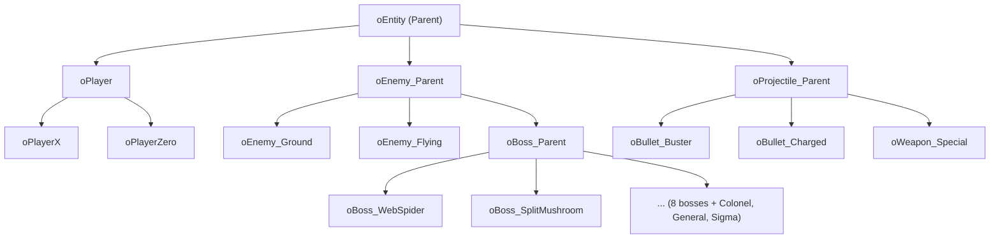
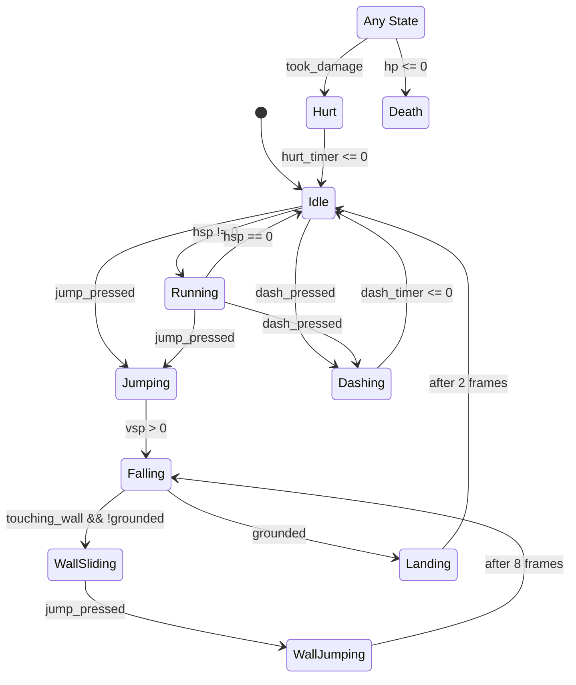
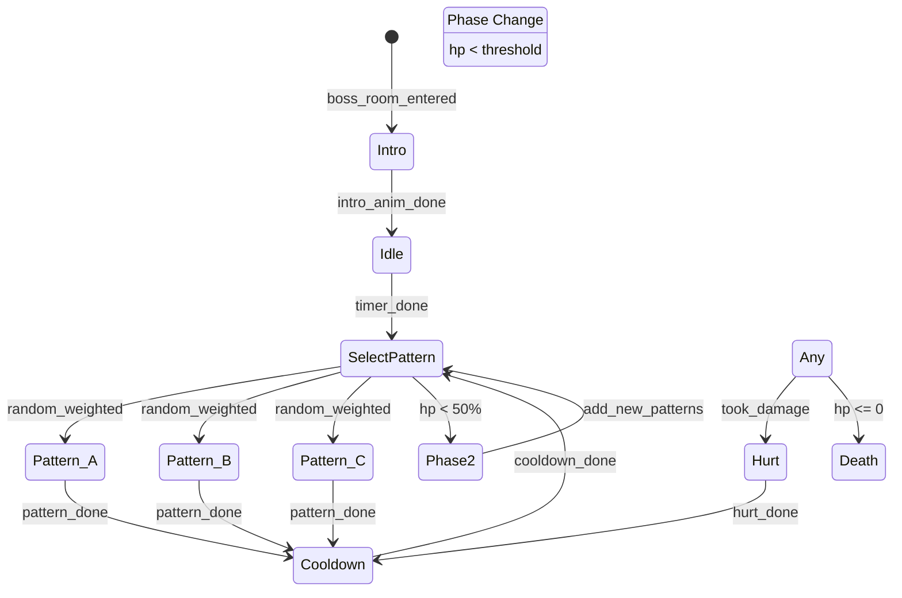
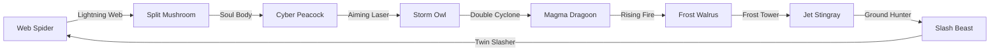
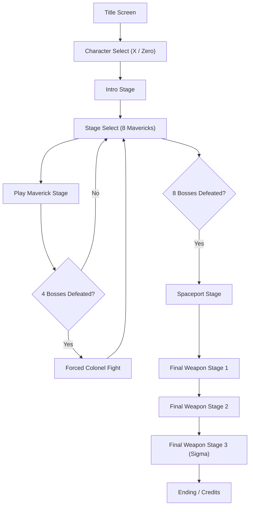
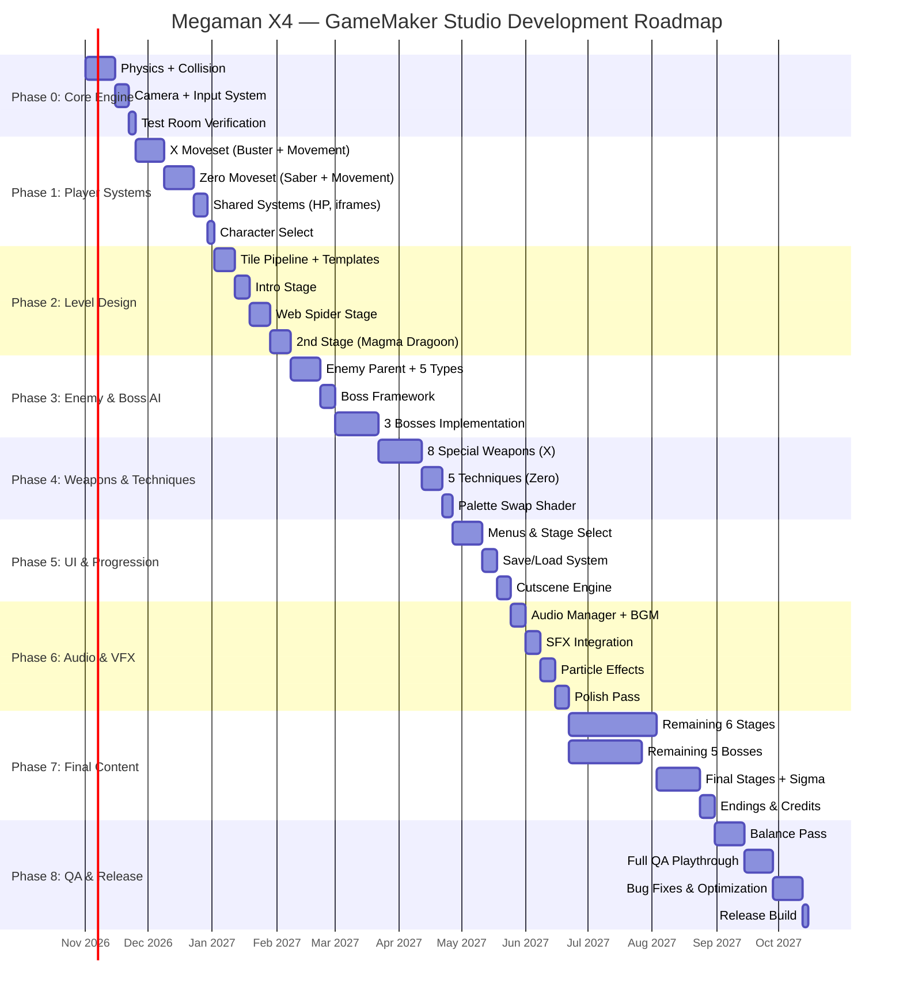

# 🎮 Kế Hoạch Phát Triển Game Megaman X4 — GameMaker Studio 2

> [!IMPORTANT]
> Đây là dự án **lớn, nhiều phase** (ước tính 6–12 tháng solo dev). Theo skill flow `/ask-matt`, đây là "huge foggy effort" → nên đi qua **`/grill-me` → `/to-spec` → `/to-tickets` → `/implement`** để triển khai có hệ thống. Kế hoạch dưới đây là **bản đồ tổng thể** trước khi đi vào từng phase.

---

## Mục Lục

1. [Tổng Quan Dự Án](#1-tổng-quan-dự-án)
2. [Kiến Trúc Dự Án GameMaker](#2-kiến-trúc-dự-án-gamemaker)
3. [Phase 0: Prototype & Core Engine](#3-phase-0-prototype--core-engine)
4. [Phase 1: Player Systems (X & Zero)](#4-phase-1-player-systems-x--zero)
5. [Phase 2: Level Design & Tile System](#5-phase-2-level-design--tile-system)
6. [Phase 3: Enemy AI & Boss System](#6-phase-3-enemy-ai--boss-system)
7. [Phase 4: Weapon & Technique System](#7-phase-4-weapon--technique-system)
8. [Phase 5: Progression, UI & Menus](#8-phase-5-progression-ui--menus)
9. [Phase 6: Audio, VFX & Polish](#9-phase-6-audio-vfx--polish)
10. [Phase 7: Final Stages & Endgame](#10-phase-7-final-stages--endgame)
11. [Phase 8: QA, Balancing & Release](#11-phase-8-qa-balancing--release)
12. [Naming Conventions & Asset Structure](#12-naming-conventions--asset-structure)
13. [Technical Specifications](#13-technical-specifications)
14. [Risk Matrix & Mitigation](#14-risk-matrix--mitigation)
15. [Roadmap Timeline](#15-roadmap-timeline)

---

## 1. Tổng Quan Dự Án

### 1.1 Mô tả
Tái tạo (fan-made recreation) tựa game **Mega Man X4** trên nền tảng **GameMaker Studio 2** (GMS2), giữ nguyên core mechanics, dual-character system (X & Zero), 8 Maverick stages + final stages, boss weakness chain, và progression system.

### 1.2 Phạm vi (Scope)

| Hạng mục | Chi tiết |
|:---|:---|
| **Nhân vật chơi** | X (ranged combat + armor system) & Zero (melee saber + techniques) |
| **Số stage** | 8 Maverick stages + Intro Stage + Colonel encounter + Spaceport + Final Weapon (3 phases) |
| **Số boss** | 8 Mavericks + Colonel + Double/Iris + General + Sigma (3 forms) |
| **Vũ khí/kỹ thuật** | 8 weapons (X) + 5 techniques (Zero) + Giga Attacks |
| **Armor** | Fourth Armor (X): Head, Body, Arm, Leg parts |
| **Collectibles** | 8 Heart Tanks, 4 Sub-Tanks, 4 Armor Parts, EX Items |
| **Resolution** | 480×270 native → scale lên fullscreen (16:9, pixel-perfect) |
| **Target FPS** | 60 FPS cố định |

### 1.3 Nguyên tắc thiết kế

1. **Faithful Mechanics First** — Ưu tiên tái tạo chính xác cảm giác điều khiển (physics, timing, hitbox) trước khi thêm polish.
2. **Modular Architecture** — Mỗi system độc lập, giao tiếp qua interfaces rõ ràng.
3. **Data-Driven Design** — Boss patterns, enemy spawns, stage layout đều load từ data (structs/JSON), không hardcode.
4. **Test Early** — Mỗi system phải chơi được (playable) trước khi sang system tiếp theo.

---

## 2. Kiến Trúc Dự Án GameMaker

### 2.1 Asset Tree Structure

```
📁 MegamanX4/
├── 📁 Objects/
│   ├── 📁 Core/          ← oGame, oCamera, oTransition, oPause
│   ├── 📁 Player/        ← oPlayer, oPlayerX, oPlayerZero
│   ├── 📁 Enemies/
│   │   ├── 📁 Common/    ← oEnemyParent, oEnemyBullet
│   │   ├── 📁 Stage1/    ← oEnemy_WebSpider_Minion, ...
│   │   └── 📁 Bosses/    ← oBoss_Parent, oBoss_WebSpider, ...
│   ├── 📁 Weapons/       ← oWeapon_Parent, oBuster, oSaber, ...
│   ├── 📁 Pickups/       ← oPickup_Health, oPickup_HeartTank, ...
│   ├── 📁 Environment/   ← oPlatform, oHazard, oBreakable, ...
│   └── 📁 UI/            ← oHUD, oMenu, oStageSelect, ...
├── 📁 Sprites/
│   ├── 📁 Player/
│   │   ├── 📁 X/         ← sX_Idle, sX_Run, sX_Jump, sX_Dash, ...
│   │   └── 📁 Zero/      ← sZero_Idle, sZero_Run, sZero_Slash1, ...
│   ├── 📁 Enemies/
│   ├── 📁 Bosses/
│   ├── 📁 Effects/       ← sFX_Explosion, sFX_ChargeParticle, ...
│   ├── 📁 UI/
│   └── 📁 Tilesets/
├── 📁 Rooms/
│   ├── 📁 Stages/        ← rIntroStage, rStage_WebSpider, ...
│   ├── 📁 Menus/         ← rTitleScreen, rStageSelect, rCharSelect
│   └── 📁 Test/          ← rTestMovement, rTestBoss, ...
├── 📁 Scripts/
│   ├── 📁 Core/          ← scr_input, scr_camera, scr_collision
│   ├── 📁 Player/        ← scr_player_states, scr_player_physics
│   ├── 📁 Combat/        ← scr_damage, scr_hitbox, scr_iframes
│   ├── 📁 AI/            ← scr_boss_ai, scr_enemy_ai
│   ├── 📁 UI/            ← scr_hud, scr_menu_nav
│   └── 📁 Data/          ← scr_weapon_data, scr_boss_data, scr_stage_data
├── 📁 Sounds/
│   ├── 📁 SFX/
│   ├── 📁 BGM/
│   └── 📁 Voice/
├── 📁 Fonts/
├── 📁 Shaders/           ← sh_flash_white, sh_palette_swap
├── 📁 Tilesets/
│   ├── ts_collision      ← collision tileset (invisible)
│   └── ts_stage_*        ← visual tilesets per stage theme
└── 📁 Extensions/
```

### 2.2 Object Inheritance Hierarchy



### 2.3 Core Singleton Objects

| Object | Vai trò | Persistent? |
|:---|:---|:---|
| `oGame` | Global game state, save/load, character selection, stage progression | ✅ Yes |
| `oCamera` | Camera follow, shake, room transitions, letterbox | ✅ Yes |
| `oInput` | Input buffering, rebinding, gamepad support | ✅ Yes |
| `oAudio` | BGM crossfade, SFX pooling, volume control | ✅ Yes |
| `oTransition` | Screen wipe, fade in/out between rooms | ✅ Yes |
| `oPause` | Pause menu, weapon/technique select overlay | ❌ No |

---

## 3. Phase 0: Prototype & Core Engine

> **Mục tiêu:** Có 1 nhân vật di chuyển, nhảy, dash, bám tường trong 1 room test với collision hoạt động hoàn hảo.

### 3.1 Physics Engine (Custom — KHÔNG dùng built-in physics)

```
Thông số cơ bản (tham khảo Megaman X4 nguyên bản):
─────────────────────────────────────────────────
Gravity:          0.25 px/frame²
Max Fall Speed:   8.0 px/frame
Run Speed:        2.5 px/frame
Dash Speed:       5.0 px/frame  (duration: ~16 frames)
Jump Velocity:    -5.5 px/frame (variable height: release early = lower)
Wall Slide Speed: 1.5 px/frame
Wall Jump X-vel:  3.0 px/frame  (decays over ~8 frames)
Wall Jump Y-vel:  -5.0 px/frame
Coyote Time:      4 frames
Jump Buffer:      6 frames
```

### 3.2 Collision System

- **Tile-based collision** sử dụng invisible collision tileset (`ts_collision`)
- Tilemap functions: `tilemap_get_at_pixel()` cho performance tối ưu
- **Collision checks riêng biệt** cho horizontal và vertical movement (tránh corner cases)
- **Sub-pixel movement** — dùng `x` và `y` là float, chỉ round khi draw
- Slope support: 45° slopes sử dụng height map trong collision tiles

```gml
// Pseudo-code cho horizontal collision
var _tilemap = layer_tilemap_get_id("Collision");
var _bbox_side = (hsp > 0) ? bbox_right : bbox_left;

if (tilemap_get_at_pixel(_tilemap, _bbox_side + hsp, bbox_top) != 0)
    || (tilemap_get_at_pixel(_tilemap, _bbox_side + hsp, bbox_bottom) != 0) {
    // Snap to grid edge
    while (!tilemap_get_at_pixel(_tilemap, _bbox_side + sign(hsp), bbox_top)) {
        x += sign(hsp);
    }
    hsp = 0;
}
x += hsp;
```

### 3.3 Camera System

| Feature | Chi tiết |
|:---|:---|
| **Follow** | Lerp theo player, deadzone ở trung tâm |
| **Room boundaries** | Clamp vào room edges |
| **Screen lock** | Lock camera khi vào boss room (triggered zones) |
| **Shake** | Random offset với decay, trigger từ impacts/explosions |
| **Transition** | Smooth scroll khi chuyển section (giống X4 original) |

### 3.4 Input System

```gml
// Input buffer struct
input = {
    right:       false,
    left:        false,
    up:          false,
    down:        false,
    jump:        false,
    jump_pressed: false,   // chỉ frame đầu
    jump_released: false,
    dash:        false,
    dash_pressed: false,
    shoot:       false,
    shoot_pressed: false,
    shoot_released: false, // cho charge shot
    special:     false,    // Zero's technique button
    special_pressed: false,
    pause:       false,
    
    // Buffers
    jump_buffer: 0,        // countdown frames
    dash_buffer: 0,
};
```

### 3.5 Deliverables Phase 0

- [x] Custom physics engine hoạt động
- [x] Tile collision system
- [x] Placeholder character chạy, nhảy, dash, wall slide/jump
- [x] Camera follow + room boundary
- [x] Input system với buffering
- [x] 1 test room để verify tất cả

---

## 4. Phase 1: Player Systems (X & Zero)

> **Mục tiêu:** Cả 2 nhân vật chơi được với đầy đủ moveset cơ bản.

### 4.1 State Machine Architecture

Sử dụng **Layered State Machine**: 1 layer cho Movement, 1 layer cho Action (attack/special).



### 4.2 X — Moveset Chi Tiết

#### 4.2.1 X-Buster (Normal)

| Level | Charge Time | Mô tả |
|:---|:---|:---|
| **Lemon shot** | 0 frames (tap) | Viên đạn nhỏ, max 3 trên screen |
| **Semi-charge** | 30 frames hold | Viên đạn trung bình, xuyên 1 enemy |
| **Full charge** | 60 frames hold | Đạn lớn, xuyên tất cả, damage cao |

#### 4.2.2 X-Buster (Fourth Armor — Plasma Shot)

| Level | Mô tả |
|:---|:---|
| **Charge Lv1** | Plasma Shot đi xuyên, để lại hitbox tại điểm chạm |
| **Charge Lv2** | Plasma Shot mạnh hơn + penetrate nhiều hơn |

#### 4.2.3 Fourth Armor Parts

| Part | Vị trí tìm | Hiệu ứng |
|:---|:---|:---|
| **Leg Parts** | Web Spider stage | Air Dash (hovering dash trong không trung) |
| **Body Parts** | Magma Dragoon stage | Giảm 50% damage, Nova Strike (Giga Attack) |
| **Arm Parts** | Frost Walrus stage | Plasma Charge Shot + Stock Charge |
| **Head Parts** | Cyber Peacock stage | Unlimited special weapon energy (ammo không giảm) |

#### 4.2.4 Special Weapons (X)

| Weapon | Boss nguồn | Input | Behavior |
|:---|:---|:---|:---|
| **Lightning Web** | Web Spider | Shoot | Bắn lưới điện dính tường, bouncing |
| **Soul Body** | Split Mushroom | Shoot | Clone bóng ma bay thẳng |
| **Aiming Laser** | Cyber Peacock | Shoot | Lock-on laser auto-aim |
| **Double Cyclone** | Storm Owl | Shoot | 2 tornado ngược chiều |
| **Rising Fire** | Magma Dragoon | Shoot | Cầu lửa bay vòng cung lên |
| **Frost Tower** | Frost Walrus | Shoot | Cột băng dưới chân |
| **Ground Hunter** | Jet Stingray | Shoot | Missile chạy trên mặt đất |
| **Twin Slasher** | Slash Beast | Shoot | 2 lưỡi cắt bay chéo |

**Charge variants:** Mỗi weapon có phiên bản charge riêng (tổng 16 projectile types).

### 4.3 Zero — Moveset Chi Tiết

#### 4.3.1 Z-Saber Combos

```
Combo đất:  Slash 1 (8f) → Slash 2 (8f) → Slash 3 (12f, finisher)
Combo trời: Air Slash (10f, single hit)
Dash Slash: Dash + Attack (10f, forward momentum)
```

#### 4.3.2 Special Techniques (Zero)

| Technique | Boss nguồn | Input | Behavior |
|:---|:---|:---|:---|
| **Raijingeki** | Web Spider | S.M (ground, neutral) | Lightning saber thrust forward |
| **Ryuenjin** | Magma Dragoon | Up + S.M (ground) | Flaming rising uppercut (dragon punch) |
| **Kuuenzan** | Slash Beast | S.M (air) | Spinning saber attack (air) |
| **Hyouretsuzan** | Frost Walrus | Down + S.M (air) | Ice downward stab plunge |
| **Rakuhouha** | Storm Owl | R2 / Giga button | Ground punch → energy spheres |
| **Hienkyaku** | Jet Stingray | Dash (air) | Air dash ability |

#### 4.3.3 Saber Dash Cancel (SDC)

```
Kỹ thuật nâng cao:
Slash 1 → Dash cancel → Slash 1 → Dash cancel → ...
Cho phép attack nhanh hơn combo bình thường
Implementation: Nếu đang ở Slash1 state + dash_pressed → cancel vào Dash state,
                reset combo counter
```

### 4.4 Shared Systems

#### 4.4.1 HP & Damage

```gml
// Player stats
hp_max      = 16;    // + 8 từ Heart Tanks = 24 max
hp_current  = 16;
iframes     = 0;     // countdown, ~60 frames sau khi bị hit
iframe_blink = true; // nhấp nháy sprite

// Damage formula
var _damage = incoming_damage;
if (has_body_armor) _damage = ceil(_damage / 2);
hp_current = max(0, hp_current - _damage);
if (hp_current <= 0) state = PLAYER_STATE.DEATH;
```

#### 4.4.2 Lives & Continue System

```
Lives mặc định: 3
Sub-Tank: Lưu energy, dùng từ pause menu để hồi HP
Game Over → Continue từ checkpoint hoặc stage select
```

### 4.5 Deliverables Phase 1

- [ ] X đầy đủ: buster (3 charge levels), dash, wall mechanics
- [ ] Zero đầy đủ: 3-hit combo, air slash, dash slash
- [ ] Hurt state, iframes, death animation
- [ ] HP bar hiển thị đúng
- [ ] Character select screen (chọn X hoặc Zero ở đầu game)

---

## 5. Phase 2: Level Design & Tile System

> **Mục tiêu:** Pipeline để build stage nhanh + 2 stage hoàn chỉnh đầu tiên.

### 5.1 Tile System

#### 5.1.1 Layers trong mỗi Room

| Layer | Type | Mục đích |
|:---|:---|:---|
| `BG_Parallax_Far` | Background | Background xa nhất, scroll chậm |
| `BG_Parallax_Mid` | Background | Background trung bình |
| `BG_Parallax_Near` | Background | Background gần |
| `Tiles_Behind` | Tile | Tiles phía sau player |
| `Tiles_Main` | Tile | Tiles chính (visual) |
| `Tiles_Front` | Tile | Tiles phía trước player (foreground) |
| `Collision` | Tile | Invisible collision tiles |
| `Instances` | Instance | Objects (enemies, pickups, triggers) |
| `Effects` | Asset | Particle effects, weather |

#### 5.1.2 Collision Tile Types

| Tile ID | Loại | Mô tả |
|:---|:---|:---|
| 0 | Empty | Không collision |
| 1 | Solid | Full block collision |
| 2 | OneWay | Chỉ block từ trên xuống |
| 3 | Slope45_L | Dốc 45° (trái lên phải) |
| 4 | Slope45_R | Dốc 45° (phải lên trái) |
| 5 | Spike | Instant kill |
| 6 | Ladder | Climbable |
| 7 | Water | Swim physics |
| 8 | Ice | Slippery surface |

### 5.2 Stage Design Document

Mỗi stage cần các thành phần:

```
Stage Blueprint:
├── Theme & Aesthetic (màu sắc chủ đạo, tileset)
├── BGM track
├── Section Map (chia stage thành sections/screens)
├── Enemy Placement Map
├── Gimmick List (cơ chế đặc biệt của stage)
├── Mini-boss (nếu có)
├── Boss Room Layout
├── Collectible Locations:
│   ├── Heart Tank (vị trí + điều kiện lấy)
│   ├── Sub-Tank (nếu có)
│   ├── Armor Part (nếu có, chỉ cho X)
│   └── EX Item (nếu có)
└── Checkpoint Positions
```

### 5.3 8 Maverick Stages — Chi Tiết

#### Stage 1: Web Spider — Jungle

```
Gimmick: Dây thừng/vine swing, mạng nhện bẫy, nền tảng rơi
Sections: 7 screens
Visual: Rừng nhiệt đới → hang nhện
Enemies: Bat drone, vine crawler, spider minion
Collectible: Heart Tank (cần Frost Tower), Leg Parts (X only)
Boss Arena: Mạng nhện nền, Web Spider treo lơ lửng
```

#### Stage 2: Split Mushroom — Bio Laboratory

```
Gimmick: Cyberspace portal (teleport), clone mechanic
Sections: 6 screens + 2 cyberspace sections
Visual: Phòng thí nghiệm → không gian cyber
Enemies: Mech robot, data drone, mushroom minion
Collectible: Heart Tank (cần Lightning Web)
Boss Arena: Phòng thí nghiệm, Split Mushroom clone attack
```

#### Stage 3: Cyber Peacock — Cyberspace

```
Gimmick: Ranking system (destroy enemies fast = higher rank = different path)
Sections: 5 screens (branching paths dựa trên rank)
Visual: Cyberspace/digital grid
Enemies: Data enemies, firewall blocks
Collectible: Heart Tank, Head Parts (X only)
Boss Arena: Digital arena, Cyber Peacock teleport attacks
```

#### Stage 4: Storm Owl — Air Force Base

```
Gimmick: Rising elevator section, wind gusts, falling platforms
Sections: 8 screens (longest stage)
Visual: Sân bay quân sự → trên trời
Enemies: Jet soldiers, turrets, aerial drones
Collectible: Heart Tank, Sub-Tank
Boss Arena: Platform trên trời, Storm Owl fly patterns
```

#### Stage 5: Magma Dragoon — Volcano

```
Gimmick: Lava rising sections, breakable floors, eruption hazards
Sections: 6 screens
Visual: Núi lửa → lòng núi → hang magma
Enemies: Fire bat, lava slime, rock thrower
Collectible: Heart Tank, Body Parts (X only), Sub-Tank
Boss Arena: Platform trên lava, Magma Dragoon fighting-game style attacks
```

#### Stage 6: Frost Walrus — Snow Base

```
Gimmick: Ice physics (trượt), snowball puzzle, ice block phá vỡ
Sections: 7 screens
Visual: Căn cứ tuyết → hang băng
Enemies: Snow trooper, ice slider, penguin robot
Collectible: Heart Tank, Arm Parts (X only)
Boss Arena: Phòng băng, Frost Walrus charge attacks
```

#### Stage 7: Jet Stingray — Marine Base

```
Gimmick: Ride Chaser section (auto-scrolling trên hovercraft)
Sections: 4 normal + 2 Ride Chaser sections
Visual: Bờ biển → dưới nước → đuổi theo tàu
Enemies: Aqua drone, mine, torpedo enemy
Collectible: Heart Tank, Sub-Tank
Boss Arena: Platform trên nước, Jet Stingray dive attacks
```

#### Stage 8: Slash Beast — Military Train

```
Gimmick: Moving train (auto-scroll), coupling gaps, wind resistance
Sections: 6 screens (linear, trên tàu)
Visual: Tàu quân sự chạy qua sa mạc
Enemies: Soldier, turret, claw bot
Collectible: Heart Tank, Sub-Tank
Boss Arena: Toa tàu cuối, Slash Beast melee attacks
```

### 5.4 Special Stage Mechanics

#### 5.4.1 Ride Chaser (Jet Stingray Stage)

```gml
// Ride Chaser object
oRideChaser:
  - Auto-scroll camera (speed tăng dần)
  - Player controls: up/down/jump/shoot
  - Obstacles: mines, barriers, gaps
  - Health: separate HP bar (ride chaser có HP riêng)
  - Destruction: nếu HP = 0 → player văng ra, tiếp tục đi bộ
```

#### 5.4.2 Ranking System (Cyber Peacock Stage)

```
Ranking tính theo:
  - Enemies destroyed / Total enemies in section
  - Time to clear section
  
Ranks: S, A, B (mỗi rank mở path khác nhau)
S-Rank path: ngắn hơn nhưng có extra rewards
B-Rank path: dài hơn, nhiều enemies hơn
```

### 5.5 Deliverables Phase 2

- [ ] Tileset pipeline + collision system hoàn thiện
- [ ] Parallax background system
- [ ] Room transition system (section-based scrolling)
- [ ] Stage template (có thể copy cho stage mới)
- [ ] 2 stages hoàn chỉnh (khuyến nghị: Intro Stage + Web Spider)
- [ ] Checkpoint system
- [ ] Ride Chaser prototype

---

## 6. Phase 3: Enemy AI & Boss System

> **Mục tiêu:** Framework cho enemies + bosses, implement 3 bosses đầu tiên.

### 6.1 Enemy Parent System

```gml
// oEnemy_Parent - Create Event
hp           = 1;
damage       = 2;       // damage gây cho player khi chạm
score        = 100;
drop_table   = [        // loot table
    { item: "health_small", chance: 0.3 },
    { item: "health_large", chance: 0.1 },
    { item: "weapon_energy_small", chance: 0.2 },
    { item: "weapon_energy_large", chance: 0.05 },
    { item: "extra_life", chance: 0.01 },
];

// States
state        = ENEMY_STATE.IDLE;
facing       = -1;      // -1 = left, 1 = right
active       = false;   // chỉ activate khi trong camera view
despawn_dist = 64;      // despawn khi ra khỏi camera bao xa

// Physics (dùng chung engine với player)
hsp = 0; vsp = 0;
gravity_force = 0.25;
```

### 6.2 Enemy Types Template

| Category | Behavior | Ví dụ |
|:---|:---|:---|
| **Ground Walker** | Đi qua lại, quay đầu khi gặp tường/vực | Mettaur, soldier |
| **Ground Shooter** | Đứng yên, bắn khi player trong range | Turret, cannon |
| **Flying Patrol** | Bay theo pattern (sin wave, circle, line) | Bat, drone |
| **Flying Chase** | Bay theo player | Homing missile, seeker |
| **Stationary** | Không di chuyển, attack khi player đến gần | Spike trap, pop-up cannon |
| **Spawner** | Spawn enemies khác theo timer | Capsule, hive |

### 6.3 Boss AI Architecture



### 6.4 Boss Data Structure (Data-Driven)

```gml
// Ví dụ: Boss Data cho Web Spider
boss_data_web_spider = {
    name: "Web Spider",
    hp: 32,
    contact_damage: 4,
    weakness: "twin_slasher",     // X
    weakness_zero: "kuuenzan",    // Zero
    weakness_multiplier: 2.0,     // damage x2 khi dùng weakness weapon
    
    phases: [
        {
            // Phase 1: HP 100% → 50%
            threshold: 0.5,
            patterns: [
                { id: "web_throw",    weight: 3, cooldown: 60 },
                { id: "descend_bite", weight: 2, cooldown: 90 },
                { id: "web_swing",    weight: 2, cooldown: 45 },
            ]
        },
        {
            // Phase 2: HP < 50%
            threshold: 0.0,
            patterns: [
                { id: "web_throw",    weight: 2, cooldown: 45 },
                { id: "descend_bite", weight: 3, cooldown: 60 },
                { id: "web_rain",     weight: 3, cooldown: 75 },  // NEW
                { id: "web_swing",    weight: 1, cooldown: 30 },
            ]
        }
    ],
    
    intro_sequence: "drop_from_ceiling",
    death_sequence: "explode_sequential",
};
```

### 6.5 Boss Weakness Chain (Recommended Order)



### 6.6 Sigma Boss Phases (Final Boss)

```
Phase 1: Sigma (humanoid form) — Beam saber, teleport, projectiles
Phase 2: Sigma (giant Grim Reaper mech) — Scythe swings, laser, summon skulls
Phase 3: (Zero route only) Sigma Head — special pattern
```

### 6.7 Deliverables Phase 3

- [ ] oEnemy_Parent với physics, damage, drops
- [ ] 5 common enemy types hoạt động
- [ ] oBoss_Parent với state machine, phase system
- [ ] 3 bosses hoàn chỉnh: Web Spider, Magma Dragoon, Frost Walrus
- [ ] Boss intro/death sequences
- [ ] Boss HP bar UI

---

## 7. Phase 4: Weapon & Technique System

> **Mục tiêu:** Tất cả 8 special weapons (X) + 5 techniques (Zero) hoạt động.

### 7.1 Weapon System Architecture (X)

```gml
// Weapon data registry
global.weapons = {
    buster: {
        name: "X-Buster",
        icon: sUI_Weapon_Buster,
        color: [120, 180, 255],   // palette swap color
        energy: -1,               // infinite
        max_energy: -1,
        
        normal: {
            object: oBullet_Buster,
            max_on_screen: 3,
            damage: 1,
        },
        charged: {
            object: oBullet_BusterCharged,
            max_on_screen: 1,
            damage: 3,
            charge_time: 60,
        }
    },
    
    lightning_web: {
        name: "Lightning Web",
        icon: sUI_Weapon_LightningWeb,
        color: [100, 255, 100],
        energy: 28,
        max_energy: 28,
        cost_normal: 2,
        cost_charged: 7,
        
        normal: {
            object: oWeapon_LightningWeb,
            max_on_screen: 2,
            damage: 2,
        },
        charged: {
            object: oWeapon_LightningWeb_Charged,
            max_on_screen: 1,
            damage: 4,
        }
    },
    // ... 6 more weapons
};
```

### 7.2 Technique System Architecture (Zero)

```gml
// Technique registry
global.techniques = {
    raijingeki: {
        name: "Raijingeki",
        input_dir: DIR.NEUTRAL,   // no direction + special
        input_state: "ground",
        hitbox: { w: 48, h: 24, offset_x: 24, offset_y: -8 },
        damage: 3,
        frames: 18,
        sprite: sZero_Raijingeki,
        element: "electric",
    },
    ryuenjin: {
        name: "Ryuenjin",
        input_dir: DIR.UP,        // up + special
        input_state: "ground",
        hitbox: { w: 24, h: 48, offset_x: 8, offset_y: -48 },
        damage: 3,
        frames: 24,
        sprite: sZero_Ryuenjin,
        element: "fire",
        // Player rises during this move
        movement: { vsp: -6, hsp: 0 },
    },
    hyouretsuzan: {
        name: "Hyouretsuzan",
        input_dir: DIR.DOWN,      // down + special (in air)
        input_state: "air",
        hitbox: { w: 16, h: 32, offset_x: 0, offset_y: 16 },
        damage: 4,
        frames: -1,               // until landing
        sprite: sZero_Hyouretsuzan,
        element: "ice",
        movement: { vsp: 8, hsp: 0 },  // plunge down
    },
    kuuenzan: {
        name: "Kuuenzan",
        input_dir: DIR.NEUTRAL,
        input_state: "air",
        hitbox: { w: 40, h: 40, offset_x: 0, offset_y: 0 },  // circular
        damage: 2,
        multi_hit: true,          // hits multiple times
        frames: 30,
        sprite: sZero_Kuuenzan,
        element: "slash",
    },
    rakuhouha: {
        name: "Rakuhouha",
        input: "giga_button",
        cost: 8,                  // weapon energy cost
        hitbox: "projectile",     // spawns energy orbs
        damage: 6,
        frames: 45,
        sprite: sZero_Rakuhouha,
        element: "energy",
    }
};
```

### 7.3 Palette Swap System

Khi X chuyển weapon, màu armor thay đổi theo weapon đang trang bị:

```gml
// Shader: sh_palette_swap
// Swap specific color ranges in the sprite
// Input: base color (X's default blue) → target color (weapon color)

// Trong Draw Event:
shader_set(sh_palette_swap);
shader_set_uniform_f(u_swap_color, 
    weapon_color[0]/255, weapon_color[1]/255, weapon_color[2]/255);
draw_self();
shader_reset();
```

### 7.4 Deliverables Phase 4

- [ ] Weapon switching UI (X: pause menu + shortcut keys)
- [ ] All 8 special weapons (normal + charged) cho X
- [ ] All 5 techniques cho Zero
- [ ] Weapon energy system + weapon energy drops
- [ ] Palette swap shader
- [ ] Giga Attack (Nova Strike cho X, Rakuhouha cho Zero)

---

## 8. Phase 5: Progression, UI & Menus

### 8.1 Game Flow



### 8.2 Save/Load System

```gml
// Save data structure
global.save_data = {
    character: "X",           // hoặc "Zero"
    
    // Progression
    stages_cleared: [],       // array of cleared stage IDs
    current_lives: 3,
    
    // Player stats
    hp_max: 16,
    heart_tanks: [],          // array of collected heart tank IDs
    sub_tanks: [
        { id: 0, collected: false, energy: 0 },
        { id: 1, collected: false, energy: 0 },
        { id: 2, collected: false, energy: 0 },
        { id: 3, collected: false, energy: 0 },
    ],
    
    // X specific
    armor_parts: {
        head: false,
        body: false,
        arm: false,
        leg: false,
    },
    weapons_unlocked: [],     // array of weapon IDs
    
    // Zero specific
    techniques_unlocked: [],  // array of technique IDs
    hienkyaku: false,         // air dash ability
    
    // Meta
    play_time: 0,             // total frames played
    death_count: 0,
};
```

### 8.3 UI Components

#### 8.3.1 HUD (In-Game)

```
┌─────────────────────────────────────────────┐
│ ┌──┐                                       │
│ │HP│ ████████████████  (player HP bar)      │
│ │  │ ████████████████                       │
│ └──┘                                       │
│ ┌──┐                                       │
│ │WP│ ██████████████    (weapon energy bar)  │
│ │  │ ██████████████                         │
│ └──┘                                       │
│                              LIVES: 3 ×    │
│                                            │
│                                            │
│                                            │
│                                            │
│ ┌──────────────────────────────────────┐   │
│ │       BOSS HP: ████████████████████  │   │ ← appears during boss fight
│ └──────────────────────────────────────┘   │
└─────────────────────────────────────────────┘
```

#### 8.3.2 Stage Select Screen

```
        ┌─────────┐
        │  Storm   │
        │   Owl    │
        └─────────┘
┌─────────┐     ┌─────────┐
│  Slash   │     │  Cyber  │
│  Beast   │     │ Peacock │
└─────────┘     └─────────┘
        ┌─────────┐
        │    X    │  ← Center: character portrait
        └─────────┘
┌─────────┐     ┌─────────┐
│   Jet   │     │  Split  │
│ Stingray │     │Mushroom │
└─────────┘     └─────────┘
        ┌─────────┐
        │  Frost  │
        │ Walrus  │
        └─────────┘
┌─────────┐     ┌─────────┐
│  Magma  │     │   Web   │
│ Dragoon │     │ Spider  │
└─────────┘     └─────────┘
```

#### 8.3.3 Pause Menu / Weapon Select

```
┌──────────────────────────────────┐
│        WEAPON SELECT             │
│                                  │
│   [Buster]  [L.Web]  [Soul]     │
│   [Laser]   [Cycl]   [Fire]     │
│   [Frost]   [Ground] [Twin]     │
│                                  │
│   Sub-Tank 1: ████  [USE]       │
│   Sub-Tank 2: ██    [USE]       │
│                                  │
│   EXIT                          │
└──────────────────────────────────┘
```

### 8.4 Cutscene System

```gml
// Cutscene data (simple scripted sequences)
cutscene_data = [
    { type: "dialog", speaker: "X", text: "Maverick! I'll stop you!", portrait: sPortrait_X },
    { type: "wait", frames: 30 },
    { type: "dialog", speaker: "Boss", text: "You cannot defeat me!", portrait: sPortrait_WebSpider },
    { type: "camera_pan", target: { x: 500, y: 200 }, speed: 2 },
    { type: "spawn", object: oBoss_WebSpider, x: 500, y: 100 },
    { type: "end" },
];
```

### 8.5 Deliverables Phase 5

- [ ] Title screen + character select
- [ ] Stage select screen (animated, cursor navigation)
- [ ] In-game HUD (HP, weapon energy, lives, boss HP)
- [ ] Pause menu + weapon/technique select
- [ ] Save/Load system (INI hoặc JSON file)
- [ ] Stage clear screen (weapon/technique get animation)
- [ ] Game Over + Continue screen
- [ ] Cutscene engine (dialog boxes + character portraits)

---

## 9. Phase 6: Audio, VFX & Polish

### 9.1 Audio System

#### 9.1.1 BGM List

| Track | Dùng cho |
|:---|:---|
| `bgm_title` | Title screen |
| `bgm_stage_select` | Stage select |
| `bgm_char_select` | Character select |
| `bgm_intro_stage` | Intro stage |
| `bgm_web_spider` | Web Spider stage |
| `bgm_split_mushroom` | Split Mushroom stage |
| `bgm_cyber_peacock` | Cyber Peacock stage |
| `bgm_storm_owl` | Storm Owl stage |
| `bgm_magma_dragoon` | Magma Dragoon stage |
| `bgm_frost_walrus` | Frost Walrus stage |
| `bgm_jet_stingray` | Jet Stingray stage |
| `bgm_slash_beast` | Slash Beast stage |
| `bgm_boss` | Boss fight (all 8 Mavericks) |
| `bgm_colonel` | Colonel battle |
| `bgm_sigma1` | Sigma stage 1 |
| `bgm_sigma2` | Sigma stage 2 |
| `bgm_sigma_battle` | Sigma boss fight |
| `bgm_ending_x` | X ending |
| `bgm_ending_zero` | Zero ending |
| `bgm_game_over` | Game Over |
| `bgm_weapon_get` | Weapon/technique get fanfare |

#### 9.1.2 SFX List (Core)

```
sfx_buster_shoot, sfx_buster_charge_loop, sfx_buster_charged_fire,
sfx_saber_slash_1, sfx_saber_slash_2, sfx_saber_slash_3,
sfx_jump, sfx_land, sfx_dash, sfx_wall_slide,
sfx_hurt, sfx_death, sfx_explosion_small, sfx_explosion_large,
sfx_health_pickup, sfx_energy_pickup, sfx_extra_life,
sfx_boss_intro, sfx_boss_hurt, sfx_boss_death,
sfx_menu_cursor, sfx_menu_select, sfx_menu_cancel,
sfx_checkpoint, sfx_gate_open, sfx_gate_close,
sfx_charge_start, sfx_technique_ryuenjin, sfx_technique_raijingeki,
sfx_sub_tank_use, sfx_heart_tank_get
```

#### 9.1.3 Audio Manager

```gml
// oAudio - manages BGM crossfade and SFX pooling
bgm_current = -1;
bgm_volume  = 0.8;
sfx_volume  = 1.0;

function play_bgm(_track, _fade_time = 30) {
    if (bgm_current == _track) return;
    if (bgm_current != -1) {
        audio_sound_gain(bgm_current, 0, _fade_time * (1000/60));
        // Schedule stop after fade
    }
    bgm_current = audio_play_sound(_track, 10, true);
    audio_sound_gain(bgm_current, bgm_volume, _fade_time * (1000/60));
}
```

### 9.2 Visual Effects (VFX)

#### 9.2.1 Particle Systems

| Effect | Dùng cho |
|:---|:---|
| Charge particles | X đang charge buster (hạt xoay vào tâm) |
| Dash dust | Bụi khi dash trên mặt đất |
| Wall slide sparks | Tia lửa khi slide trên tường |
| Landing dust | Bụi khi tiếp đất |
| Explosion (small) | Enemy death |
| Explosion (sequential) | Boss death (multi-point) |
| Hit spark | Khi đạn/saber chạm enemy |
| Damage flash | Enemy/boss nhấp nháy trắng khi bị hit |

#### 9.2.2 Screen Effects

```gml
// Flash trắng khi boss death
function screen_flash(_duration) {
    flash_alpha = 1.0;
    flash_duration = _duration;
}

// Slow-motion khi kill boss
function hitstop(_frames) {
    global.hitstop_timer = _frames;
    // Trong Step Event của oGame:
    // if (global.hitstop_timer > 0) { global.hitstop_timer--; return; }
}
```

### 9.3 Polish Checklist

- [ ] Screenshake khi lớn explosion
- [ ] Hitstop (1-3 frames freeze) khi đánh trúng
- [ ] Sprite squash & stretch khi landing
- [ ] Smooth camera với proper deadzone
- [ ] Particle trails cho charged shots
- [ ] Boss death: sequential explosions → white flash → silence → fanfare
- [ ] Stage intro: "READY" text → fade in
- [ ] Weapon get: pose animation + weapon name display + fanfare

### 9.4 Deliverables Phase 6

- [ ] Audio manager với crossfade
- [ ] Tất cả SFX placeholder (có thể thay bằng custom sounds sau)
- [ ] Particle systems cho tất cả effects listed
- [ ] Screen flash, hitstop, screenshake
- [ ] Boss death sequence hoàn chỉnh
- [ ] Stage intro/outro sequences

---

## 10. Phase 7: Final Stages & Endgame

### 10.1 Colonel Encounter (Forced — sau 4 Mavericks)

```
Trigger: Sau khi clear stage thứ 4 (bất kỳ)
Location: Stage Select bị interrupt → cutscene → Colonel fight
Đặc biệt: 
  - X route: Colonel là enemy
  - Zero route: Iris xuất hiện, Colonel là rival
Boss Pattern: Sword dash, rising slash, projectile deflect
```

### 10.2 Spaceport Stage

```
Sections: 5 screens
Gimmick: Zero-gravity sections, conveyor platforms
Mini-boss: Dựa theo character (Double cho X, Iris cho Zero)
```

### 10.3 Final Weapon — 3 Stages

#### Stage 1: Exterior

```
Sections: 4 screens
Gimmick: Boss rush (rematch 4 random Mavericks — capsule rooms)
Environment: Space station exterior
```

#### Stage 2: Interior

```
Sections: 4 screens
Gimmick: Boss rush (rematch remaining 4 Mavericks)
Environment: Space station corridor
```

#### Stage 3: Core

```
Sections: 2 screens + 3 boss rooms
Boss sequence:
  1. Colonel rematch (stronger)
  2. General (giant mech — multi-phase)
  3. Sigma Phase 1 (humanoid)
  4. Sigma Phase 2 (giant Grim Reaper)
```

### 10.4 Endings

```
X Ending:
  - Cutscene: X reflects on fighting
  - Credits roll
  
Zero Ending:
  - Cutscene: Iris death scene, Zero's grief
  - Credits roll
  
Both: 
  - Staff credits with character art montage
  - "Thank you for playing" screen
  - Return to title
```

### 10.5 Deliverables Phase 7

- [ ] Colonel boss fight (2 versions: mid-game + final)
- [ ] Double boss fight (X route)
- [ ] Iris boss fight (Zero route)
- [ ] General boss fight (multi-phase)
- [ ] Sigma 3-phase boss fight
- [ ] Boss rush rooms (capsule teleporter system)
- [ ] Spaceport + Final Weapon stages (3 stages)
- [ ] Ending cutscenes (X & Zero routes)
- [ ] Credits sequence

---

## 11. Phase 8: QA, Balancing & Release

### 11.1 Balancing Parameters

```
Tuning targets:
─────────────────────────────────────────
Average stage clear time: 8-12 minutes
Boss fight duration: 90-180 seconds
Death rate for new player: ~3-5 per stage
Heart Tank value: +1 HP (total +8 = 24 max HP)
Sub-Tank capacity: 16 HP (full heal ≈ 2/3 max HP)

Damage chart:
  Player normal shot → enemy:  1-2 damage
  Player charged shot → enemy: 3-4 damage
  Player saber combo → enemy:  2-2-3 (per hit)
  Enemy contact → player:      2-4 damage
  Boss contact → player:       3-5 damage
  Boss attack → player:        4-6 damage
  Spikes/lava:                 instant death
```

### 11.2 QA Checklist

- [ ] **Collision edge cases:** corners, 1-pixel gaps, ceiling bonk
- [ ] **State machine deadlocks:** không bị stuck trong state nào
- [ ] **Boss patterns:** không có unbeatable patterns, mọi attack đều dodge được
- [ ] **Weapon balance:** mọi weapon đều useful, weakness 2x nhưng không quá OP
- [ ] **Performance:** 60 FPS ổn định trên target hardware
- [ ] **Memory leaks:** tất cả instances được cleanup khi rời room
- [ ] **Save/Load:** data integrity, không corrupt save
- [ ] **Full playthrough X:** start → all stages → Sigma → ending
- [ ] **Full playthrough Zero:** start → all stages → Sigma → ending
- [ ] **Speedrun viable:** không có softlocks, skip-friendly physics

### 11.3 Deliverables Phase 8

- [ ] Damage/HP balance pass
- [ ] Full QA playthrough (cả 2 characters)
- [ ] Bug fix sweep
- [ ] Performance optimization (draw calls, instance count)
- [ ] Build final executable

---

## 12. Naming Conventions & Asset Structure

### 12.1 Object Naming

| Prefix | Loại | Ví dụ |
|:---|:---|:---|
| `o` | Object | `oPlayer`, `oCamera`, `oGame` |
| `oEnemy_` | Enemy object | `oEnemy_BatDrone`, `oEnemy_Soldier` |
| `oBoss_` | Boss object | `oBoss_WebSpider`, `oBoss_Sigma` |
| `oBullet_` | Projectile | `oBullet_Buster`, `oBullet_Charged` |
| `oWeapon_` | Special weapon | `oWeapon_LightningWeb` |
| `oPickup_` | Collectible | `oPickup_HealthSmall`, `oPickup_HeartTank` |
| `oUI_` | UI element | `oUI_HUD`, `oUI_BossHP` |
| `oFX_` | Visual effect | `oFX_Explosion`, `oFX_DashDust` |
| `oTrigger_` | Trigger/zone | `oTrigger_BossGate`, `oTrigger_Checkpoint` |

### 12.2 Sprite Naming

```
Pattern: s[Character]_[Action]_[Variant]

Ví dụ:
  sX_Idle, sX_Run, sX_Jump, sX_Fall, sX_Dash, sX_DashJump
  sX_WallSlide, sX_WallJump, sX_Shoot_Idle, sX_Shoot_Run
  sX_Charge_Lv1, sX_Charge_Lv2, sX_Hurt, sX_Death
  
  sZero_Idle, sZero_Run, sZero_Slash1, sZero_Slash2, sZero_Slash3
  sZero_AirSlash, sZero_Ryuenjin, sZero_Hyouretsuzan
  
  sBoss_WebSpider_Idle, sBoss_WebSpider_Attack1
  
  sFX_Explosion_Small, sFX_ChargeParticle
  sUI_HPBar, sUI_WeaponIcon_Buster
```

### 12.3 Script Naming

```
Pattern: scr_[system]_[function] hoặc function-based grouping

Scripts (file):
  scr_player_states     → chứa: state_idle(), state_run(), state_jump(), ...
  scr_player_physics    → chứa: move_and_collide(), apply_gravity(), ...
  scr_combat            → chứa: deal_damage(), apply_knockback(), ...
  scr_boss_ai           → chứa: boss_select_pattern(), boss_execute_pattern(), ...
  scr_camera            → chứa: camera_follow(), camera_shake(), ...
  scr_input             → chứa: input_update(), input_check_buffer(), ...
  scr_save              → chứa: save_game(), load_game(), ...
  scr_weapon_data       → chứa: init_weapon_database(), ...
```

### 12.4 Room Naming

```
Pattern: r[Category]_[Name]

rMenu_Title, rMenu_CharSelect, rMenu_StageSelect
rIntro_Stage
rStage_WebSpider, rStage_SplitMushroom, rStage_CyberPeacock, ...
rStage_Spaceport, rStage_FinalWeapon_1, rStage_FinalWeapon_2, rStage_FinalWeapon_3
rTest_Movement, rTest_Combat, rTest_Boss
```

---

## 13. Technical Specifications

### 13.1 Engine Settings

| Setting | Value |
|:---|:---|
| **GameMaker Version** | GameMaker Studio 2 (LTS hoặc Monthly) |
| **Game Speed** | 60 FPS |
| **Room Resolution** | 480 × 270 pixels (native) |
| **Display Resolution** | Upscale to window/fullscreen (pixel-perfect scaling) |
| **View/Camera** | 1 camera per room, 480×270 viewport |
| **Collision** | Tile-based (tilemap functions), **KHÔNG** dùng built-in physics |
| **Target Platform** | Windows (primary), extensible to others |

### 13.2 Performance Targets

| Metric | Target |
|:---|:---|
| Max instances per room | < 200 |
| Max active enemies | < 15 (deactivate off-screen) |
| Max particles | < 500 |
| Draw calls | Minimize — batch sprites, reduce surface usage |
| Memory | < 512 MB |

### 13.3 Key Technical Challenges

| Challenge | Giải pháp |
|:---|:---|
| **Pixel-perfect collision** | Custom collision trên tilemap, sub-pixel tracking |
| **60 FPS consistency** | Deactivate off-screen enemies, object pooling cho bullets |
| **Boss AI complexity** | Data-driven patterns, weighted random selection |
| **Dual character system** | Shared parent (oPlayer), character-specific children override methods |
| **Palette swap (X)** | Fragment shader swap color ranges |
| **Large room management** | Section-based camera locks, lazy instance activation |
| **Save data integrity** | JSON serialize + checksum validation |

---

## 14. Risk Matrix & Mitigation

| Risk | Severity | Likelihood | Mitigation |
|:---|:---|:---|:---|
| **Scope creep** | 🔴 High | 🔴 High | Strict phase gates, cut features early |
| **Art asset volume** | 🔴 High | 🔴 High | Placeholder sprites first, hire pixel artist hoặc dùng community assets |
| **Boss AI tuning** | 🟡 Medium | 🟡 Medium | Data-driven patterns, easy to iterate |
| **Physics feel "off"** | 🟡 Medium | 🟡 Medium | Reference original frame data, A/B test early |
| **Burnout (solo dev)** | 🔴 High | 🔴 High | Phase deliverables = playable milestones, celebrate wins |
| **Legal (Capcom IP)** | 🔴 High | 🟡 Medium | Label as fan-game, non-commercial, original assets |
| **GMS2 limitations** | 🟢 Low | 🟢 Low | GMS2 handles 2D action games well |

---

## 15. Roadmap Timeline

> [!NOTE]
> Ước tính cho **1 solo developer**, working part-time (~15-20h/tuần). Full-time sẽ nhanh gấp 2-3x.



### Ước tính tổng thời gian

| Phase | Thời gian (tuần) |
|:---|:---|
| Phase 0: Core Engine | 3-4 tuần |
| Phase 1: Player Systems | 5-6 tuần |
| Phase 2: Level Design (2 stages) | 4-5 tuần |
| Phase 3: Enemy & Boss AI | 6 tuần |
| Phase 4: Weapons & Techniques | 5 tuần |
| Phase 5: UI & Progression | 4 tuần |
| Phase 6: Audio & VFX | 4 tuần |
| Phase 7: Final Content | 8-10 tuần |
| Phase 8: QA & Release | 6 tuần |
| **Tổng** | **~45-50 tuần (~10-12 tháng)** |

---

## Bước Tiếp Theo — Recommended Flow

Theo skill map `/ask-matt`, với dự án ở quy mô này:

1. **Ngay bây giờ:** Dùng `/grill-me` để stress-test kế hoạch này — xác định scope cut, priority, và risks bạn muốn chấp nhận.

2. **Sau khi align xong:** Tạo working directory, chạy `/grill-with-docs` để ghi lại decisions vào `CONTEXT.md` + ADRs.

3. **Chia tickets:** `/to-spec` → `/to-tickets` cho Phase 0 trước (core engine). Mỗi ticket là 1 session `/implement`.

4. **Build:** `/implement` từng ticket theo thứ tự blocking edges, `/clear` context giữa các tickets.

5. **Prototype khi cần:** Nếu không chắc physics feel đúng → `/prototype` trong folder riêng trước khi commit vào main.

> [!TIP]
> **Khuyến nghị mạnh:** Bắt đầu từ Phase 0 + Phase 1 trước. Khi nhân vật chạy nhảy dash "feel right", mọi thứ khác build lên trên đó sẽ nhanh hơn nhiều. Đừng cố làm hết 8 stages cùng lúc — làm 1 stage hoàn chỉnh (pipeline), sau đó nhân bản.

---

> **Document version:** 1.0  
> **Last updated:** 2026-10-10  
> **Author:** Antigravity AI Assistant
